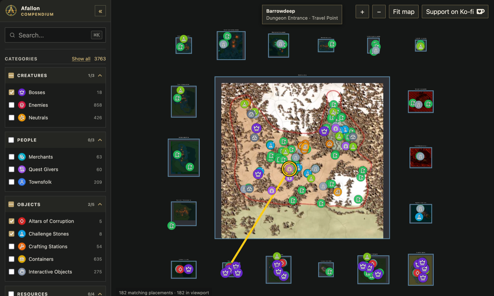
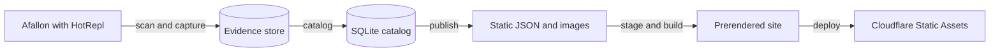

# Afallon Compendium

Afallon Compendium is an interactive world map and searchable reference for players of the single-player RPG [Afallon](https://store.steampowered.com/app/2597810/Afallon/). It uses the game's own data to show where to find things and how they relate. This is an unofficial fan project, not affiliated with the game's developer or publisher.

[Open the compendium](https://afallon.compendiums.org/) · [Steam Guide](https://steamcommunity.com/sharedfiles/filedetails/?id=3800843227) · [Project page](https://glockyco.com/projects/afallon/)



The map combines the game's maps with searchable placements and category filters.

## Use the compendium

- Explore the overworld and interiors to find creatures, merchants, quest givers, resources, containers, and entrances.
- Search reference pages for items, NPCs, quests, places, classes, skills, and abilities. Follow their links to drops, shops, requirements, and locations.
- Read the mechanics pages for progression, crafting, gathering, corruption, loot, and World Quests.
- Check the site's release information and Coverage page before relying on data that may be incomplete.

You do not need a game installation to use the published site. The source checkout is for changing the site or rebuilding its data.

## Setup

Use the Bun version declared in [`package.json`](package.json). The default Nix shell provides the site and pipeline tools:

```sh
nix develop
bun install --frozen-lockfile
```

Without Nix, install the tools declared in [`flake.nix`](flake.nix). Runtime extraction also needs a local Afallon installation with [HotRepl](https://github.com/glockyco/HotRepl) loaded. [`config.example.json`](config.example.json) documents the local paths and connection settings.

### Run and build the site

The repository does not include a publication of extracted game data. You need a selected publication root and the accepted publication directory used as its comparison baseline. Obtain those from an existing local extraction or follow the pipeline procedure below.

From the repository root, replace the placeholders with your local directories:

```sh
bun run stage:production <publication-root> <accepted-publication-directory>
bun run dev
```

Staging validates the publication and checks for unexplained losses against the baseline. It writes the staged files into this checkout, so stage separately in every checkout where you run the site.

To build and preview the staged production site:

```sh
bun run build:production
bun run compendium preview
```

The preview command rebuilds the site and serves it with its production response headers. Neither the built site nor the published site needs a database or game connection at runtime.

## Extract and publish game data



HotRepl runs the probes in [`packages/scan`](packages/scan/) and [`packages/capture`](packages/capture/) inside the game. Scans read game records and authored world objects. Captures produce map imagery. The evidence store keeps immutable objects and manifests, and the catalog records unresolved facts as coverage issues rather than guessing them.

The [game-update procedure](.agent/skills/game-update/SKILL.md) covers installing a build, preparing plans, scanning, capturing maps, reviewing game rules, building a candidate, comparing it with the accepted data, and accepting it. Use that procedure rather than treating extraction as a single export command. The CLI lists its commands and arguments with:

```sh
bun run compendium --help
```

Game binaries, saves, recovered code, raw evidence, and extracted artwork stay out of Git. The pipeline writes its evidence under the ignored `artifacts/` directory. Read the update procedure before accepting data or removing stored evidence.

### Deploy the site

Authenticate Wrangler from `apps/site` before deploying:

```sh
cd apps/site
bunx wrangler login
cd ../..
```

From the repository root, supply the baseline again because deployment stages the publication itself:

```sh
PUBLICATION_BASELINE_ROOT=<accepted-publication-directory> bun run compendium deploy <publication-root>
```

This command stages the selected publication, builds and validates the site, publishes its static files to Cloudflare, and smoke-tests production. It does not deploy a database or runtime game probes. `bun run rollback:production` uses Wrangler to roll back the deployed site.

## Change the project

The checks are:

```sh
bun run check
bun run check:dependencies
bun run test
bun run --cwd apps/site check
```

The Python tests use uv. For browser work, stage a publication built from the current schemas and inspect the affected pages in a browser.

- [`apps/site`](apps/site/) contains the SvelteKit pages, search, map, and deployment scripts.
- [`apps/compendium-cli`](apps/compendium-cli/) is the pipeline command line. The packages under [`packages/`](packages/) implement evidence storage, runtime access, extraction, catalog construction, and publication.
- [`openspec/specs`](openspec/specs/) holds behavior requirements, including reader presentation and data contracts.
- [`.agent/skills`](.agent/skills/) holds procedures for [game updates](.agent/skills/game-update/SKILL.md), [runtime inspection](.agent/skills/hotrepl-runtime-inspection/SKILL.md), and [native analysis](.agent/skills/native-analysis/SKILL.md).
- [`packages/contracts/planner-reference.md`](packages/contracts/planner-reference.md) explains the planner payload, talent-rule evidence, and remaining evidence gates. Consult it before changing planner data or evaluation.

## License

The code is licensed under the [MIT License](LICENSE). Afallon's names, artwork, and game assets belong to their respective rights holders.
